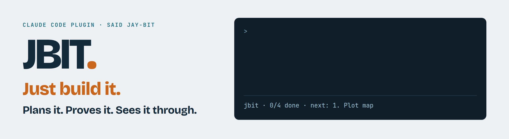

<h1 align="center">
  <picture>
    <source media="(prefers-reduced-motion: reduce) and (prefers-color-scheme: dark)" srcset="docs/assets/jbit-hero-dark.png">
    <source media="(prefers-reduced-motion: reduce)" srcset="docs/assets/jbit-hero-light.png">
    <source media="(prefers-color-scheme: dark)" srcset="docs/assets/jbit-hero-dark.webp">
    
  </picture>
</h1>

**JBIT** (*jay-bit*, for Just Build It). You bring the goal; JBIT **plans it**. Approve the plan and say `JBIT, just build it.` JBIT does the rest: it **proves it** and **sees it through**, logging the calls it makes for you and stopping before anything it can't take back.

It's a Claude Code plugin for long, multi-stage work, on new projects and existing ones. All project state lives in one plan file plus git, with no tracker or codebase map to keep current.

For a visual walkthrough (interactive autopilot simulation, the stage loop, guardrails and roadmaps), download [docs/field-guide.html](docs/field-guide.html) and open it in a browser.

## From goal to done

1. **You state a goal.** Say what you want built, or point Claude at a spec.
2. **One plan.** `/jbit:plan` writes `docs/PLAN.md`: the goal, stages with a risk line and acceptance checks you can observe, dated decisions and open questions. In existing code it surveys what the work touches and records a test baseline first. When the goal turns on facts outside the repo (a regulation, a standard, how an outside API really behaves), one research agent answers the questions that would change the plan and writes each answer, with dated sources, to `docs/research/<topic>.md`, and decisions resting on a finding link the note. A question paper can't settle becomes a `Spike:` stage, answered by a throwaway prototype. A goal with no such question skips research in one line. The plan's current position rides in Claude's context, so it survives long sessions and compaction, and new work either fits the goal or waits for the next plan.
3. **Build a stage.** `/jbit:stage` builds the next stage, fanning independent parts out to subagents as far as the plan's Agents line allows, each on the model and effort its Models line sets.
4. **Verify it, with evidence.** `/jbit:verify` runs the project's checks, then proves each acceptance check by a test or against the running product, and saves the report and output to `docs/evidence/stage-<n>/`.
5. **Review it.** The risk line is checked against what the code actually touches. Anything beyond UI gets a fresh-eyes review by an agent that didn't write it, with a security pass where it matters.
6. **Commit it.** One commit per stage, evidence included. Hooks refuse a commit that closes a stage without its evidence or carries a secret. Then it stops for your review.
7. **Autopilot sees it through.** `JBIT, just build it.` (or `/jbit:autopilot`) runs every remaining stage as project manager, without stopping in between. After each stage you get a notification and, when someone reads along, a short progress note: concerns first, what was delivered and how it was proven, and what's left. A headless run leaves the note to the final report. A concern (a check failing again, a review finding being fixed, a risk line that grows) is told in one line when it happens.
8. **Next plan.** When the goal is met, `/jbit:plan` archives the plan and its evidence and starts the next one fresh.

Any command also works by name at the start of a message, in any case: "JBIT plan a CSV tool", "JBit, resume", "jbit: verify". Along the way, `/jbit:fix` takes a small, low-risk change without a stage, `/jbit:charter` turns a PRD too big for one plan into a roadmap of milestones, and `/jbit:resume` picks things up after a break.

## Who's in charge

Once you've seen the plan, your own command runs autopilot unattended: a typed `/jbit:autopilot`, or a message that opens with "JBIT" and holds nothing but command words ("JBIT autopilot lean", "JBIT, just build it. Autopilot, lean."). Claude builds risky stages and settles open decisions itself, logging each one for you. It lasts until your next command or a new plan goal. It works in a headless run (`claude -p`) and on a session's first turn too, since the hook attaches the run's rules beside your command. A headless run leaves the progress note between stages to the final report, which covers each stage.

- Say `attended` in the command and it stops, enforced by hooks, before a risky stage (auth, money, personal data or your project's own risk words) until you approve it, and for decisions only you can make. A held stage gets no file edits outside the plan and its `docs/research/` notes.
- Say `outward` to let push, publish and deploy through; otherwise those stay blocked. Migrating or deleting real data and spending money still pause. The outward check covers shell commands, not web searches: research queries go out at any level, briefed to carry only the domain question. Reading isn't held: a read-only `curl` or `wget` GET passes, while anything that sends (a body, an upload, credentials, an auth or cookie header) waits, and the hold points to WebFetch and WebSearch for reading pages.
- Plain words without the name ("just build it", "take it from here") never set the level: they run at the one that stands, attended unless your own command set one for this plan. Your own plain reply ("yes", "just build it") approves a stage it's holding.
- Claude starting autopilot itself, a plugin's prompt or anything in a file never sets the level or approves a stage, and a Mode line left from an earlier session doesn't start a run.

It removes waiting, not checks: verification, the commit gates, the secret guard and the security review of risky stages stay, and it still stops when it's stuck and before building a plan you haven't seen.

## Moving over from keel

JBIT was called keel up to 0.11.0. To switch an existing install:

```
claude plugin uninstall keel@keel-local
claude plugin marketplace remove keel-local
claude plugin marketplace add onedigerati/jbit
claude plugin install jbit@jbit-local
```

Use the path to your local clone in place of `onedigerati/jbit` if you install from a clone, then start a new session. Commands are now `/jbit:*`; the old `/keel:*` commands no longer exist. Your repos need no edits: `Keel risk:` and `Keel outward:` lines in `CLAUDE.md` and `keel:allow-secret` markers still work, alongside `JBIT risk:`, `JBIT outward:` and `jbit:allow-secret`.

## In short

- **State.** One plan file plus git. With a PRD too big for one plan, `docs/ROADMAP.md` adds milestones and a requirement ledger, and a milestone closes only on evidence that its requirements are covered.
- **Evidence.** Each verified stage leaves a per-check report and its output in `docs/evidence/`, committed with the stage. A stage can't be closed without its report. Under autopilot, a command line that writes the plan and commits is refused, and a close found only after a line ran is checked against its commit and flagged to reopen if it fails.
- **Agents level.** An `Agents: lean | wide` line in the plan sets how widely work fans out to subagents, trading tokens for wall-clock time; no line is balanced. `lean` is held to one running agent by a hook, and `wide` is honoured only once you confirm it in the session.
- **Models.** A `Models: build sonnet/medium · review opus/high` line in the plan sets the model and effort each delegated role's agents start on: `build`, `research`, `review` and `verify`, each `model/effort` (either half optional). Research agents get the `research` setting, so the research that once ran on the session's model can run on a cheaper one. A role the line leaves out takes your own default (or a confirmed project default) when there is one, else runs as the session. Set it with your own `JBIT models build sonnet/medium`; `JBIT models default` goes back to the project default (a `JBIT models:` line in `CLAUDE.md`), and `JBIT models none` removes the line. A project default counts only once you confirm it in the session, so a cloned repo's committed default never raises spend unasked. `JBIT models build sonnet/medium · research sonnet/high — my default` also saves the settings as your own default, kept outside every repo: a new plan in any repo starts from it. `JBIT models clear my default` removes it, and `JBIT models` alone shows where each role's setting comes from. The status line shows it, and the hook denies an agent started with a setting no role has. Planning and project management run in the main session, so they stay on the session's model: change that with `/model`. Only you set effort; Claude passes what the line names and never picks one.
- **Small agents.** A fan-out gives each agent a small batch, a few items at most (a nine-item research list goes to agents of at most three each), and every brief asks the agent to read narrowly, stop when its brief is done and hand back a short report (20 lines at most, no diffs or dumps): an agent's cost grows with its turns and context.
- **Project risk rules.** `JBIT risk:` and `JBIT outward:` lines in `CLAUDE.md` add your project's own hold words and outward commands. They only add to the built-ins, never loosen them.
- **Secret guard.** A commit that would carry a secret is blocked, and credential headers in evidence must be masked.

## Install

```
claude plugin marketplace add onedigerati/jbit
claude plugin install jbit@jbit-local
```

See [plugins/jbit/README.md](plugins/jbit/README.md) for the full story, every skill and hook, project risk rules, the secret guard, evidence, roadmaps, Agents levels, Models and evals.

## Copilot CLI

JBIT also runs on GitHub Copilot CLI. `plugins/jbit-copilot/` is the same plugin, version 2.0.0, generated from this one by `node hosts/build.mjs copilot`: the same skills with a note on Copilot's tool names, and the hook ported to a Node script. It needs Node 22.18 or later.

```
copilot plugin marketplace add onedigerati/jbit
copilot plugin install jbit@jbit-local
```

The GitHub form works once the Copilot package is pushed; from a local clone, use `copilot plugin marketplace add /path/to/jbit`. Copilot reads its own marketplace file, `.github/plugin/marketplace.json`, so it installs the Copilot package, not the Claude one.

Type `/jbit:plan`, `/jbit:stage`, `/jbit:autopilot` and so on. A typed `/plan`, `/review` or `/autopilot` is Copilot's own command, not JBIT's.

What works, proven headless on Copilot CLI 1.0.114: the plan's `## Now` reaches the model with every prompt, a stage runs to its close and commit, the commit gate refuses a stage close with an unticked check, the secret guard refuses a commit carrying a key, a `git push` under autopilot is held, an edit in a held stage is refused, autopilot carries on into the next stage (proven with a run told to end its turn after stage 1, since a model often finishes small stages in one turn), and the commit gate holds inside a `task` subagent.

What Copilot can't do:

<!-- copilot-gaps:start: generated from hosts/copilot/capability.json by node hosts/build.mjs copilot; don't edit -->
- **Stall detection.** Each hook event is a fresh process, so nothing counts repeated turn ends; Copilot's cap of 8 agentStop blocks per prompt bounds the loop instead.
- **Lean's count of agents already running.** The Claude hook keeps it in memory across events; a command hook has no running process to keep it in.
- **Tracking background agents.** Same reason: no in-memory agent list between events.
- **The reopen check after a commit.** It runs before the commit lands, since there's no in-memory state carried to the next event.
- **The guard on `edit` and `create`.** Covered on their documented shape with fixture tests only: no model this account offers writes through them, so no live run proved them. `bash` and `apply_patch` are proven.
- **Long unattended runs under `copilot -p`.** agentStop gets 8 blocks per prompt, so an unattended run stops quietly at its 9th turn end; use Copilot's --autopilot or prompt again.
- **Typed `/plan`, `/review`, `/autopilot`.** They are Copilot's own commands; type `/jbit:plan`, `/jbit:review`, `/jbit:autopilot`.
- **Node older than 22.18.** The hook runs the Claude hook's TypeScript through Node's type stripping; an older Node can't load it, so guarded tool calls are refused.
- **`/code-review` and `/security-review`.** They are Claude Code built-ins; on Copilot the review runs as a `task` agent (`code-review`, `security-review`) or a fresh agent with the same lenses.
- **Worktree isolation for parallel builders.** Copilot's `task` has none, so parallel builders must own separate files or run one at a time.
- **Compacting the context before autopilot carries on.** Copilot gives a command hook no context gauge and no compact call (the shim reports 0% and skips compaction); Copilot manages its own context.
- **The stage hold and the secret guard inside a `task` subagent.** Only the commit gate was proven inside a subagent (stage 4, run 12); in the runs meant to test the hold and the secret guard there, the model declined to delegate, so those two are unproven in a subagent.
- **A hook that hangs or prints junk.** Copilot refuses a call when a preToolUse hook exits non-zero, but lets the call run when the hook prints something other than JSON or outlasts its 30-second timeout (proven at stage 4 on a scratch copy). The shipped hook prints only JSON and refuses by its own 25-second watchdog, so this bites only if the hook's event loop blocks.
- **The hook's own messages.** They are the Claude hook's words and name Claude tools (Agent, Edit, Write); each skill's mapping section translates them.
- **Running the screenshot script headless.** Skills name it as `<verify skill folder>/scripts/capture.mjs`; a live run (stage 3) proved the model sees the skill's folder and runs the installed script, and a headless run (`copilot -p`) is denied running a file outside the project unless it allows the plugin's folder with `--add-dir <plugin folder>`. Per Copilot's docs, an interactive session asks for the path instead, and `--allow-all-paths` also allows it.
<!-- copilot-gaps:end -->

## Codex CLI

JBIT also runs on OpenAI Codex CLI. `plugins/jbit-codex/` is the same plugin, version 2.0.0, generated from this one by `node hosts/build.mjs codex`: the same skills with a note on Codex's tool names, and the hook ported to a Node script. It needs Node 22.18 or later.

```
codex plugin marketplace add onedigerati/jbit
codex plugin add jbit@jbit-local
```

The GitHub form works once the Codex package is pushed; from a local clone, use `codex plugin marketplace add /path/to/jbit`. Codex reads its own marketplace file, `.agents/plugins/marketplace.json`, so it installs the Codex package, not the Claude one.

**Trust the hooks first.** Codex runs a plugin's hooks only once you trust them: at startup the TUI says "Hooks need review"; choose "Trust all", or review them in `/hooks`. Do it again after every JBIT update, which voids the trust. Until then nothing guards, no plan reaches the model, and nothing says so. Trusted hooks run outside Codex's sandbox.

Invoke a skill as `$jbit:<name>`: `$jbit:plan`, `$jbit:stage`, `$jbit:autopilot`. A typed `/jbit:plan` is plain text to Codex. The hook reads a leading `$jbit:autopilot` or `$jbit:approve` as the typed `/jbit:autopilot` or `/jbit:approve`.

Headless, run `codex exec "<prompt>" < /dev/null` from the project (without `< /dev/null` it waits for more input on stdin). Under `--sandbox workspace-write`, `.git` is read-only, so a stage can't commit until you make it writable: `-c 'sandbox_workspace_write.writable_roots=["<project>/.git"]'`. `--dangerously-bypass-hook-trust` runs the hooks without saved trust; use it in CI only.

What works, proven headless on Codex CLI 0.171.0 from the marketplace install: the plan's `## Now` reaches the model with every prompt, a stage runs to its close and commit, the commit gate refuses a stage close with an unticked check, the secret guard refuses a commit carrying a key, a `git push` under autopilot is held, an edit through `apply_patch` in a held stage is refused, a write under `$CODEX_HOME` is refused, autopilot carries on through the turn end and stops at the hook's cap, the hooks fire for `Bash` and `apply_patch` calls inside `spawn_agent` children, and `approve` is left out of the skills Codex shows the model (it wasn't invoked when asked to approve).

What Codex can't do:

<!-- codex-gaps:start: generated from hosts/codex/capability.json by node hosts/build.mjs codex; don't edit -->
- **Hooks need trusting after every install and update.** Codex runs a plugin's hooks only once the user trusts them, at startup ("Hooks need review", then "Trust all") or through `/hooks`, and every JBIT update voids that trust silently. Until they're trusted again, JBIT has no `## Now` in context, no gates and no carry-on, and nothing says so; `codex exec` skips untrusted hooks without a warning. Trusted hooks run outside the sandbox.
- **A hook killed on timeout.** A PreToolUse hook that Codex kills on its 30-second timeout lets the call run (proven live at stage 7). The shipped hook refuses by its own 25-second watchdog first, and refuses when its own modules fail to load, so this bites only if the hook's event loop blocks.
- **Stall detection and other in-memory state.** Each hook event is a fresh process, as on Copilot, so nothing counts repeated turn ends; the hook's own cap of 8 Stop blocks per prompt bounds the loop instead, and an unattended `codex exec` run stops quietly when it's reached. Prompt again to carry on.
- **Lean's count of agents already running.** The Claude hook keeps it in memory across events; a command hook has no running process to keep it in.
- **Tracking background agents.** Same reason: no in-memory agent list between events.
- **The reopen check after a commit.** It runs before the commit lands, since there's no in-memory state carried to the next event.
- **A `## Now` longer than 40 lines.** JBIT passes at most 40 lines of `## Now` into context, as on Claude Code: a longer one reaches the model cut at its 40th line (proven live, along with 40 lines passed whole). Keep `## Now` short.
- **The brief of a `spawn_agent` call.** Codex hands the hook the brief (`message`) encrypted, so no check can read it. The stage hold and the Models line still apply to the call; nothing that needs the brief's words does.
- **Some tool calls inside `spawn_agent` children.** The hooks fire for `Bash` and `apply_patch` calls a subagent makes (proven live), but whether they fire for its `write_stdin` and MCP tool calls is unproven.
- **Writes through the shell in a held stage.** The hold refuses `apply_patch` and builder agents, but a file written by a shell command (`echo > file`, `sed -i`) isn't held, on any host: the hook can't tell a build step from a read in a shell line.
- **The `$CODEX_HOME` guard.** Writes under `$CODEX_HOME` or a `.codex` folder are refused through `apply_patch` and through shell commands that name the folder, but the shell check is best-effort: a command that reaches the folder without naming it isn't caught.
- **Case-insensitive file systems.** The guard compares paths case-sensitively, so on a case-insensitive file system (macOS, Windows) a write to `.Codex/` or to `$CODEX_HOME` spelled in another case can slip past it.
- **No role agents.** A Codex plugin can't register agents (none of the routes the spike tried did), so the package ships none; builders, verifiers and reviewers are plain `spawn_agent` calls briefed with the role.
- **`CLAUDE.md` loaded at startup.** Codex loads `AGENTS.md`, not `CLAUDE.md`; the skills tell the model to read `CLAUDE.md` itself.
- **Typing `/jbit:<name>`.** Codex recognises a skill only as `$jbit:<name>` (for example `$jbit:autopilot`). A typed `/jbit:plan` or `$plan` reaches the model as plain text, which may still find the skill from its description, with no guarantee. The hook reads a leading `$jbit:autopilot` or `$jbit:approve` as the typed command.
- **Node older than 22.18.** The hook runs the Claude hook's TypeScript through Node's type stripping; an older Node can't load it, so guarded tool calls are refused.
- **`/code-review` and `/security-review`.** They are Claude Code built-ins; on Codex the review runs as a fresh `spawn_agent` briefed with the same lenses.
- **Worktree isolation for parallel builders.** Codex's `spawn_agent` has none, so parallel builders must own separate files or run one at a time.
- **Compacting the context before autopilot carries on.** Codex gives a command hook no context gauge and no compact call; Codex manages its own context.
- **The hook's own messages.** They are the Claude hook's words and name Claude tools (Agent, Edit, Write); each skill's mapping section translates them.
- **Screenshots inside the workspace-write sandbox.** In a stage 3 `codex exec` run under `--sandbox workspace-write`, Chromium could not start (it aborted at launch with `shutdown: Operation not permitted`), so `capture.mjs` stopped with "The browser would not launch"; with the sandbox off (`--dangerously-bypass-approvals-and-sandbox`) the same script took the screenshot. So run it outside the workspace-write sandbox (with Codex's approval, or a full-access sandbox such as `--sandbox danger-full-access`). Finding the script works: a live run showed the model fills `<verify skill folder>/scripts/capture.mjs` from the `SKILL.md` path Codex lists for the skill.
<!-- codex-gaps:end -->
