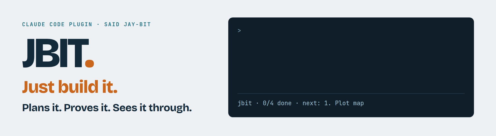

<h1 align="center">
  <picture>
    <source media="(prefers-reduced-motion: reduce) and (prefers-color-scheme: dark)" srcset="../../docs/assets/jbit-hero-dark.png">
    <source media="(prefers-reduced-motion: reduce)" srcset="../../docs/assets/jbit-hero-light.png">
    <source media="(prefers-color-scheme: dark)" srcset="../../docs/assets/jbit-hero-dark.webp">
    
  </picture>
</h1>

**JBIT** (*jay-bit*, for Just Build It). You bring the goal; JBIT **plans it**. Approve the plan and say `JBIT, just build it.` JBIT does the rest: it **proves it** and **sees it through**, logging the calls it makes for you and stopping before anything it can't take back.

It's a Claude Code plugin for long, multi-stage work, on new projects and existing ones. All project state lives in one plan file plus git. Durable facts (how to run and test) go in `CLAUDE.md`.

## From goal to done

1. **You state a goal.** Say what you want built, or point Claude at a spec. "Plan it out", "JBIT plan" or `/jbit:plan` starts the plan.
2. **One plan, cut into stages.** `/jbit:plan` writes `docs/PLAN.md`: the goal, the current position (`## Now`), stages each with a risk line and acceptance checks you can observe, dated decisions and open questions. In existing code it first surveys what the work touches and records the test run as a `## Baseline`, so old failures aren't blamed on new work. When the goal turns on facts outside the repo (a regulation, an outside API), a `researcher` agent answers the questions that would change the plan, with dated sources, in `docs/research/<topic>.md`. A question paper can't settle becomes a `Spike:` stage, answered by a throwaway prototype.
3. **Build a stage.** `/jbit:stage` (or "go") scopes the next stage, builds shared pieces first and hands independent parts to `builder` agents. Tests travel with risky logic, and untested code gets a test of what it does today before it changes.
4. **Verify it, with evidence.** `/jbit:verify` runs the type check, lint, tests, build and a dependency audit, then proves each acceptance check by its test or by driving the running product. The report and output go to `docs/evidence/stage-<n>/`. A stage is never called done on red.
5. **Review it.** The risk line is checked against what the diff actually touches. Anything beyond UI only gets `/code-review`, plus `/security-review` when it touches user input, auth, money, personal data, secrets or external services. Findings are fixed now, deferred to open questions, or rejected with a reason.
6. **Commit it.** One commit per stage, with its evidence and the updated plan. Then it stops for your review.
7. **Autopilot sees it through.** `JBIT, just build it.` (or `/jbit:autopilot`) runs the remaining stages in a row (see [Autopilot](#autopilot)).
8. **Next plan.** When the goal is met, `/jbit:plan` archives the plan to `docs/plans/<date>-<plan>.md` with its evidence beside it, carries forward the decisions that still bind, and starts the next plan fresh.

Any command works by name at the start of a message, in any case, with a space, comma or colon after the name: "JBIT plan a CSV tool", "JBit, resume", "jbit: verify".

## Autopilot

Approve a plan and say `JBIT, just build it.`, "take it from here" or `/jbit:autopilot`. The main session becomes the project manager: builders build, and it verifies (or has a fresh `verifier` do it), reviews, commits and keeps the plan current, stage after stage. Calls inside the plan's intent (a library, a name, an edge case) it makes itself, logged as dated `(autopilot)` decisions and listed first in its final report.

It stops for you only when:

- a check still fails after three fix rounds;
- a builder's report and the evidence disagree;
- the plan proves wrong and the Goal or scope would have to change;
- the next step is outward or hard to undo: push, publish, deploy, sending data out, migrating or deleting real data, spending money.

Concerns that don't stop it (a check failing after the second fix round, a must-fix review finding, a risk line that grows) are told in one line when they happen. After each stage, when someone reads along, you get a short progress note; a headless `claude -p` run leaves it to the final report. A run can span turns: your go or `/loop` continues it from `## Now`. It never builds a plan you haven't seen.

Outward safety is Claude Code's own: permission modes and the sandbox decide what may run without asking.

## Install

From GitHub:

```
claude plugin marketplace add onedigerati/jbit
claude plugin install jbit@jbit-local
```

From a local clone, use its path in place of `onedigerati/jbit`. The plugin is read straight from the clone, so edits take effect after `/reload-plugins`. For one session without installing: `claude --plugin-dir ~/repos/jbit/plugins/jbit`.

## Skills

| Command | What it does |
| --- | --- |
| `/jbit:plan` | Creates or updates `docs/PLAN.md`: goal, `## Now`, stages with a risk line and acceptance checks (each naming its proof), dated decisions, open questions. Surveys existing code and records a baseline; researches outside facts into `docs/research/`. Asks once whether to chart work too big for one plan. Archives a finished plan and starts the next. |
| `/jbit:stage` | Runs the next stage: scope, build (independent parts to `builder` agents), test, verify, review, update the plan, commit, stop for you. Also the quick-fix path: a small, decided, UI-only or docs change is built in the main session, logged as one line under the plan's `## Fixes` and committed alone. Anything touching money, auth, data, user input, secrets or dependencies becomes a stage. |
| `/jbit:verify` | The project's checks and a dependency audit, then each acceptance check proven in the running product. For a plan stage, saves a per-check report to `docs/evidence/stage-<n>/`. At the plan's last stage it re-runs earlier stages' checks that weren't proven by a test. |
| `/jbit:autopilot` | Runs the remaining stages in a row as project manager, logging `(autopilot)` decisions and stopping only for the cases above. |
| `/jbit:resume` | After a break or a context summary: reads the plan, the commits since the last stage and uncommitted work, and says where things stand and what's next. |
| `/jbit:charter` | Turns a PRD too big for one plan into `docs/ROADMAP.md` and hands the first milestone to `/jbit:plan` (see [Large projects](#large-projects)). |

Claude also uses them on its own when the moment fits.

### Role agents

JBIT's skills hand delegated work to four role agents, defined in the plugin's `agents/` folder:

- **`builder`** builds one leaf of a stage: writes the code and its tests, runs them, and reports back.
- **`reviewer`** reviews work it didn't write, with fresh eyes, against the plan's intent.
- **`verifier`** checks finished work against the running product and the project's own checks.
- **`researcher`** looks up a research question (web or domain) for a plan or a stage and reports what it found.

The plugin's files set no model or effort, so each role runs as the session. A same-named agent file of your own takes over: the skills start a role by its bare name (`builder`) when you've defined one, and by the plugin's name (`jbit:builder`) otherwise.

- **For one project**, copy the role's file to `.claude/agents/<role>.md` in that repo (for example `.claude/agents/builder.md`).
- **For every repo**, copy it to `~/.claude/agents/<role>.md`.

A project file beats your user file, which beats the plugin's. Then change only the two fields in its frontmatter:

```yaml
model: sonnet
effort: medium
```

`model:` takes `sonnet`, `opus`, `haiku`, `fable`, a full model ID, or `inherit`; `effort:` takes `low`, `medium`, `high`, `xhigh` or `max`. Your file replaces the plugin's whole definition, not just those fields, so start from a copy of the plugin's file and keep the rest as it is. The skills never pass `model` or `effort` on the Agent call, since that would beat your file. The environment variables `CLAUDE_CODE_SUBAGENT_MODEL` (with `CLAUDE_CODE_SUBAGENT_MODEL_FORCE=1`) and `CLAUDE_CODE_EFFORT_LEVEL` beat these per-role settings when set.

## Slower machines

`/jbit:stage`, `/jbit:autopilot` and `/jbit:plan` follow a limit written in plain words in `CLAUDE.md` on how many agents run at once, or on worktrees. With a number, at most that many run at a time, and the leaves go one after another. With no worktrees, builders work in the main tree on separate files. With agents off, the work runs in the main session.

- **For every repo on a machine**, add a line to `~/.claude/CLAUDE.md`: `JBIT: at most one agent at a time, no worktrees.`
- **For one project**, add it to that project's `CLAUDE.md`: `JBIT: at most two agents at a time.`

It's an instruction Claude follows, not an enforced cap. For a hard stop, deny the Agent tool in your settings with `permissions.deny`:

```json
{
  "permissions": { "deny": ["Agent"] }
}
```

That costs every subagent: no parallel builders, no fresh verifier that built nothing, and research and surveys run in the main session. More of the main context goes on the work, and stages are slower.

## Evidence

When `/jbit:verify` checks a plan stage, it writes `docs/evidence/stage-<n>/`:

- `report.md`: a row per acceptance check (check, pass or fail, a link to the proof), the commit it was verified on, and a history of failures and their fixes. A failing check is recorded as fail; one it couldn't prove is unproven, with the reason.
- A text file per proof (test run, CLI run, request and response), with the command on the first line.
- Screenshots, traces and videos.

On first use it creates `docs/evidence/.gitignore`, which keeps images, traces, videos and HAR files local; the report and text output are committed with the stage. Before saving, verify masks secrets and personal data (tokens, cookies, `Authorization` headers, database URLs, emails, names), keeping what the value was: `postgres://[masked]@db:5432/app`. When the next plan starts, the folder moves beside the archived plan.

## Large projects

For a PRD with many requirements or several releases, `/jbit:plan` asks once whether to chart it. `/jbit:charter` turns the PRD into `docs/ROADMAP.md`: milestones with dependencies, a requirement ledger under the PRD's own IDs, what's out of scope and open questions. It proposes the PRD's locked decisions (stack, data formats, product rules) for `CLAUDE.md` and writes them on your yes; process rules are never taken from a PRD.

Plans are cut one milestone at a time, and each check names the requirements it proves: `- [ ] Booking a free plot marks it booked (proof: test) (req: PLT-02)`. When a plan is archived, a requirement's `Covered by` cell is filled with a link to it only when a passing evidence row proves it. A milestone closes on the full suite, a coverage check, a fresh agent's sample of requirement-to-evidence fit and a milestone review, written to `docs/evidence/milestone-<ID>.md`. Under autopilot a milestone close is a stop: it cuts the next plan and waits for your yes. When the PRD changes, `/jbit:charter` re-charts in place: new rows added, removed ones marked `dropped <date>`, coverage never cleared.

```markdown
## Requirements
| ID | Requirement | PRD § | Milestone | Covered by |
|----|-------------|-------|-----------|------------|
| ACC-01 | A member signs up with email and password | 3.1 | M1 | [Accounts](plans/2026-11-20-accounts.md) |
| PLT-02 | A plot shows as free \| booked \| overdue | 4.2 | M2 | |
```

A project without `docs/ROADMAP.md` has none of this.

## Hook

The hook does two jobs:

- **Plan context.** When a project has `docs/PLAN.md` (or `PLAN.md`, or `docs/BUILD_PLAN.md`), its `## Now` section (up to 40 lines) rides in Claude's system prompt, so the current stage survives long sessions and compaction, and the summarizer is told to keep the stage state. The status line shows `jbit · stage <n> of <m> · <name>`, or `jbit · all stages done`. Nothing in `## Now` is parsed. Projects without a plan file are untouched.
- **Secret guard.** Before any `git commit` Claude runs, the changes it would carry are scanned for private keys, cloud and API tokens, JWTs, bearer tokens, database URLs with passwords, long hard-coded credentials and files such as `.env`. In `docs/evidence/`, a credential header (`Authorization`, `Cookie` and the like) that still holds a value is refused too. A hit blocks the commit and names the file, line and kind, never the value. Mark a false positive with `jbit:allow-secret` on that line (`keel:allow-secret` still works). It doesn't see commits made outside Claude's Bash tool, through git aliases, or from scripts; pair it with a `pre-commit` scanner such as gitleaks.

## Upgrading from 0.18

1.0.0 cuts JBIT down to what still earns its place, and hands the rest to Claude Code:

- **Gone:** `/jbit:fix`, `/jbit:approve` and `/jbit:review`; the plan's `Agents:` and `Models:` lines and the `JBIT models` commands; unattended, attended and outward levels, approval replies and risky-stage holds; the stage-close commit gate, the outward check and the worktree notice; `JBIT risk:` and `JBIT outward:` lines in `CLAUDE.md`.
- **Instead:** quick fixes are part of `/jbit:stage`; review is `/code-review` and `/security-review`; model and effort per role are set in agent files ([Role agents](#role-agents)); autopilot always runs the same way, with the stops listed above; outward safety is Claude Code's permission modes and sandbox; the evidence rule lives in the skills.
- **Your plans need no edits.** Old `Mode:`, `Agents:` and `Models:` lines in `## Now` are shown to Claude as text and ignored.

Reinstall from the marketplace (`claude plugin install jbit@jbit-local`) or run `/reload-plugins`, then start a new session. JBIT was called keel up to 0.11.0; to move from keel, uninstall `keel@keel-local` and install as above.

## Development

`claude plugin validate .` checks the manifests and hooks, and `claude plugin test plugins/jbit` runs the tests. Those run in a sandbox with no file access, so the text checks on the skills, READMEs and manifests run under Node: `node --test plugins/jbit/tests/docs.check.mjs`.

`evals/` holds an eval suite for `claude plugin eval`: triggering, planning, verification, review and roadmap cases, each building a small project with its own `scaffold.sh`. Each run is a real Claude session on your credentials, so it costs money:

```
claude plugin eval plugins/jbit --scaffold --allow-tools Bash Edit Write --runs 3
```

`--case <name>` or `--tag <tag>` runs a subset. By default each case also runs without the plugin, so the report shows what JBIT adds. Cases that use Bash run in a sandbox that refuses to start if a credential store such as `~/.docker` contains symlinks (common with Docker Desktop on WSL); run those on another machine, in CI, or headless and grade the transcript by hand.
